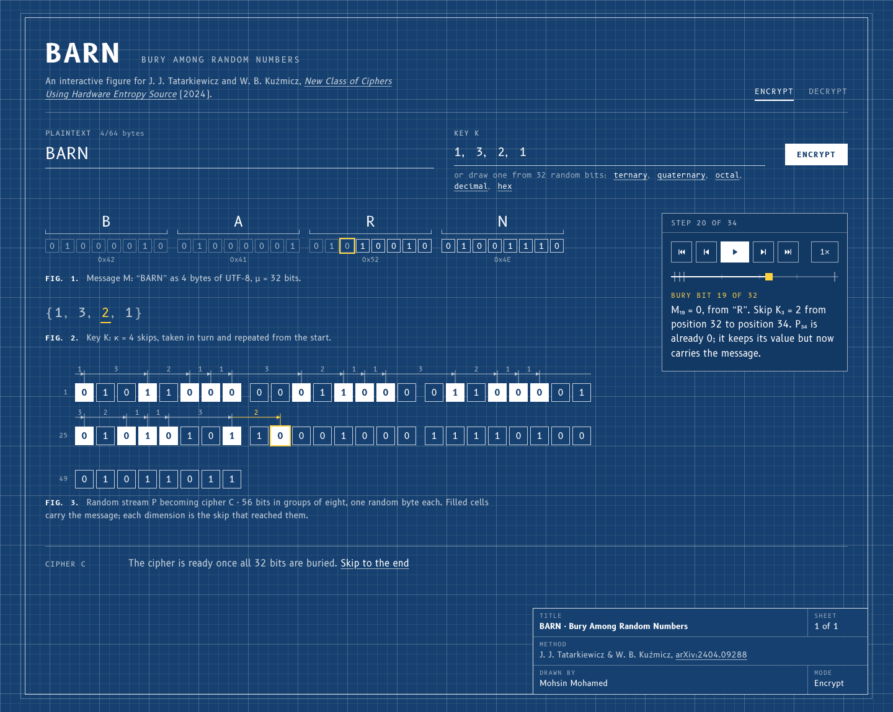
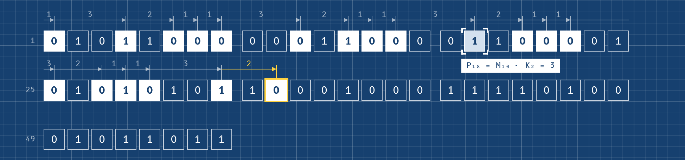
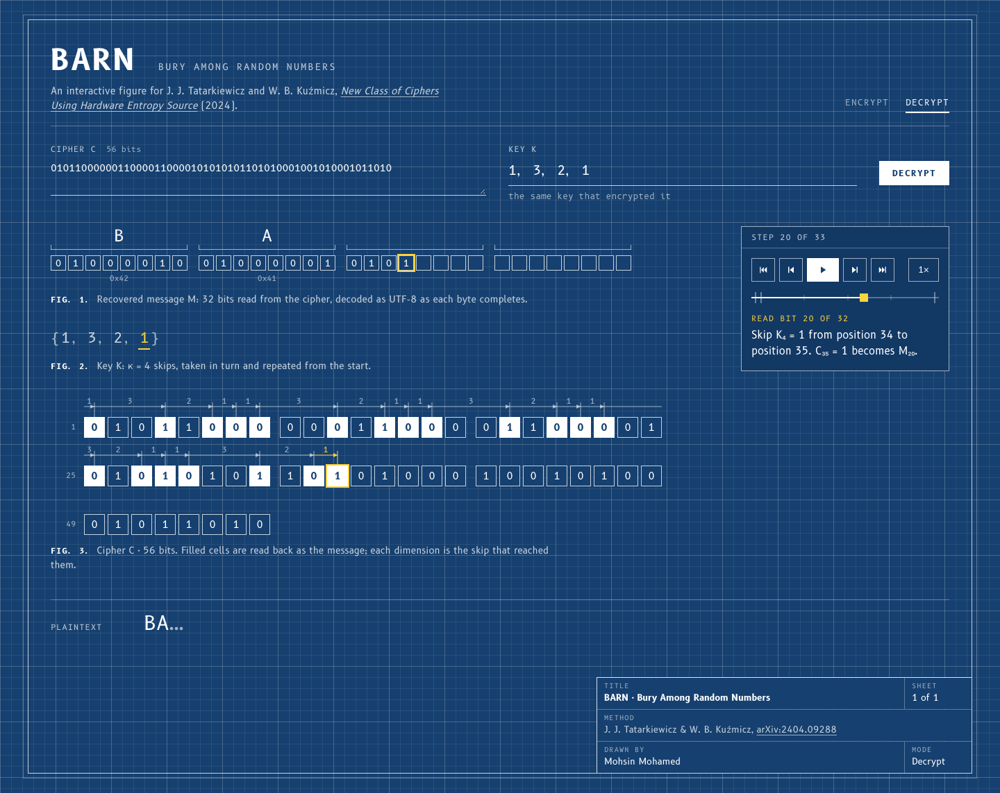
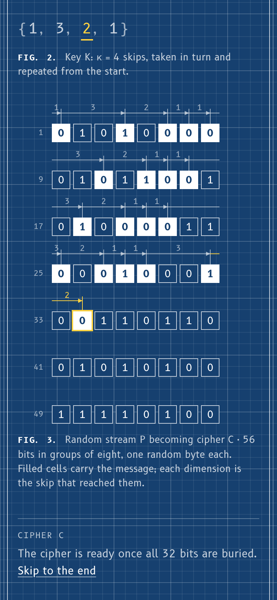

# BARN: Bury Among Random Numbers

An interactive, step-by-step visualiser for the BARN cipher. Type a message
and watch its bits get buried in a stream of random bits, one skip at a time,
then dig them back out with the key. The page is drawn as a blueprint: the
stream is a figure on an engineering drawing, and every skip is a dimension
line.



## Credit

BARN is the work of **Jan J. Tatarkiewicz and Wiesław B. Kuźmicz** (RANDAEMON
sp. z o.o.), published as:

> J. J. Tatarkiewicz and W. B. Kuźmicz, "New Class of Ciphers Using Hardware
> Entropy Source", arXiv:2404.09288 [cs.CR], 2024.
> <https://arxiv.org/abs/2404.09288>

This project is an independent teaching implementation of the method described
in that paper. Algorithm 1, Eq. (1), the key rules and the key-generation
schemes all come from it, and the worked example from its Figs. 1–4 is used as
a test. The paper is distributed by arXiv under its non-exclusive licence, so
it isn't included here; read it at the link above.

## How BARN works

Take a stream of random bits P and a key K of κ positive whole numbers. Start
just before the stream, move forward K₁ bits and write the first message bit
where you land, move forward K₂ more and write the second, and so on, starting
over at K₁ when the key runs out. The stream up to the last written bit is the
cipher C. Anyone with the key can repeat the moves and read the message back.
Without it, the paper argues, the written bits are statistically hard to tell
apart from the random ones around them.

The paper's worked example (Figs. 1–3) buries M = 1110001101 in a random
stream with K = {1, 3, 2, 1}. Written bits are bold, and the bottom row is the
skip that reached each one:

| bit #  | 1     | 2 | 3 | 4     | 5 | 6     | 7     | 8     | 9 | 10 | 11    | 12 | 13    | 14    | 15    | 16 | 17 | 18    |
| ------ | ----- | - | - | ----- | - | ----- | ----- | ----- | - | -- | ----- | -- | ----- | ----- | ----- | -- | -- | ----- |
| P      | 0     | 0 | 0 | 1     | 1 | 0     | 1     | 0     | 0 | 0  | 0     | 0  | 1     | 0     | 1     | 1  | 1  | 0     |
| C      | **1** | 0 | 0 | **1** | 1 | **1** | **0** | **0** | 0 | 0  | **0** | 0  | **1** | **1** | **0** | 1  | 1  | **1** |
| skip   | 1     |   |   | 3     |   | 2     | 1     | 1     |   |    | 3     |    | 2     | 1     | 1     |    |    | 3     |

The position of the j-th message bit has a closed form, the paper's Eq. (1):

$$
i = \left\lfloor \frac{j-1}{\kappa} \right\rfloor \sum_{l=1}^{\kappa} K_l + \sum_{l=1}^{t} K_l,
\qquad t = j - \left\lfloor \frac{j-1}{\kappa} \right\rfloor \kappa
$$

Key rules from Sec. 3 of the paper, enforced here: no element may be 0 (two
message bits would land on the same stream bit), and the key can't be all 1s
(that copies the message into consecutive bits). Sec. 3 also builds keys from
random bits in base 3, 4, 8, 10 or 16; the "draw one from 32 random bits"
links next to the key field do exactly that.

## Where the random bits come from

BARN's security rests on the stream P being truly unpredictable. The paper
gets it from a hardware true random number generator (TRNG), which measures
a physical process. A web page can't reach one directly, so this project uses
the closest thing it has:

1. `randomBits(n)` in `src/lib/barn.ts` asks for ⌈n / 8⌉ bytes from
   `crypto.getRandomValues()`, the browser's cryptographically secure random
   number generator. The operating system seeds that generator from hardware
   noise, such as interrupt timing and the CPU's own random-number
   instruction.
2. Each byte is unpacked into 8 bits, most significant bit first, and the
   first n bits become P. Any spare bits from the last byte are dropped.
3. Nothing is seeded or repeated: every encryption, including pressing
   Encrypt again on the same text, draws a fresh stream. Key generation uses
   the same source.

The visualiser shows this at the "Random stream P" step. Each group of eight
cells in Fig. 3 is one of those random bytes, its value is printed above it,
and the narration lists the actual bytes drawn.

## Running it

You need [Node.js](https://nodejs.org) 22.18 or newer.

```bash
npm install
```

```bash
npm run dev
```

Then open the address it prints (usually <http://localhost:5173>).

| Command             | What it does                                                                  |
| ------------------- | ----------------------------------------------------------------------------- |
| `npm run dev`       | Starts the dev server with hot reload                                         |
| `npm run build`     | Type-checks, then writes one self-contained `dist/index.html`                 |
| `npm run preview`   | Serves the production build locally                                           |
| `npm test`          | Runs the test suite                                                           |
| `npm run typecheck` | Runs the TypeScript compiler in strict mode                                   |

`dist/index.html` has all the JavaScript and CSS inlined, so it opens straight
from disk by double-clicking. It only needs a connection for the web fonts and
falls back to system fonts without one.

## Using the visualiser

**Encrypt.** Type a message (up to 64 bytes of UTF-8, so emoji and accents
work) and a key such as `1, 3, 2, 1`, then press **Encrypt** to watch it play.
Fig. 1 shows the message as UTF-8 bytes and bits, Fig. 2 the key, and Fig. 3
the random stream turning into the cipher. Each step the head counts out the
skip, the next message bit flies down and is stamped into its cell, and the
narration says what happened in the paper's notation (M₄, K₂, P₇ and so on).
The skip is drawn above the row as a dimension line, as on an engineering
drawing: from the previous buried bit to this one, labelled with its length.
A skip that runs past the end of a row carries on at the start of the next.



**Decrypt.** The Decrypt tab picks up the latest cipher and key, or you can
paste your own. The message length doesn't need to be entered: the cipher ends
exactly on the last buried bit, so the key alone determines how many bits it
holds. Try a different key to see what a wrong guess produces, as in the
paper's Fig. 4. The page flags keys that don't fit the cipher or don't give
whole bytes.



**Reading the drawing.** Filled cells carry the message. Drafting yellow
marks only the head: the cell being written or read, the skip in use, and the
message bit it belongs to. The title block in the corner of the sheet names
the method and its authors, as a drawing's title block would.

**Controls.** The step card in the margin beside the figures (above them on
narrower screens) has play, pause, step, jump and speed controls, a scrubber
with a mark for each phase and byte, and the narration. Hover the scrubber to
see what each step does. Point at any bit and the pointer's label names it,
for example `P₁₄ = M₈ · K₄ = 1`, while its partner in the other figure lights
up.



| Key       | Action                 |
| --------- | ---------------------- |
| Space     | Play / pause           |
| ← / →     | Previous / next step   |
| Home, End | Jump to start / end    |

With a mouse or trackpad the pointer is a reticle: four corner brackets that
snap around whatever you point at and name it. It's modelled on React Bits'
[Target Cursor](https://reactbits.dev/animations/target-cursor), without the
spin. Text fields keep the normal text cursor, and touch screens keep their
own. All animation, the reticle included, is skipped if your system asks for
reduced motion.

## How the code is organised

```
index.html                Vite entry point
docs/screenshots/         The images in this README
src/
  lib/barn.ts             The cipher: Algorithm 1, Eq. (1), parsing, UTF-8, keys (Sec. 3)
  lib/timeline.ts         Splits an encryption or decryption into steps; narration
  lib/player.ts           Form checks and the playback reducer
  lib/drawing.ts          Fig. 3's geometry: cell positions and dimension lines
  useCipher.ts            React hook wiring player.ts to the page, one per mode
  animation.ts            Step animations (Web Animations API)
  components/             Masthead, Inputs, the three figures, Output, Player (step card),
                          TitleBlock, TargetCursor
  styles.css              The blueprint: sheet, grid, linework, title block, reticle
tests/
  barn.test.ts            The cipher
  timeline.test.ts        The step model and narration
  player.test.ts          Form checks and playback
  drawing.test.ts         Dimension lines and cell geometry
```

`src/lib` has no React or DOM code, so it can be tested on its own. Every
step on screen is computed from the run and the step number alone, and the
animations only decorate a state React has already drawn. That's what makes
playing, scrubbing and stepping backwards always agree with one another.

## Tests

```bash
npm test
```

101 tests run on Node's built-in test runner (no test dependencies). They cover:

- **The paper's worked example:** burying Fig. 2 in Fig. 1 gives exactly
  Fig. 3, at positions 1, 4, 6, 7, 8, 11, 13, 14, 15 and 18, in 18 bits, with
  the count of ones going from 7 to 9 as the paper notes. Reading the Fig. 3
  cipher with the guessed key {2, 1, 2, 1} gives the paper's 001100001011
  (Fig. 4).
- **Eq. (1):** agrees with Algorithm 1 for random keys and lengths, and
  working out the message length undoes computing the stream length.
- **Round trips** for ASCII, accents, CJK, emoji, combining marks, control
  characters, a leading byte-order mark, an empty message and 2000 characters,
  plus 300 random texts under random keys.
- **Input checks:** keys with 0, only 1s, decimals, signs, exponents, words or
  oversized skips are rejected; ciphers with anything but 0 and 1 are rejected.
- **Wrong or damaged ciphers:** wrong keys, truncated ciphers, an extra
  trailing bit, ciphers too short to hold anything.
- **Randomness:** every encryption draws a fresh stream, bits are balanced,
  large requests work past the 64 KiB `getRandomValues` limit.
- **Key generation (Sec. 3):** each base maps bit groups to digits as
  described; average key sizes match Table 1 and average skips match the
  paper's growth factors (1.5×, 2×, 4×, 5×, 8×).
- **The step model:** a 2000-move random walk of next/previous/scrub checks
  every step against a from-scratch reconstruction, including v1's failing
  sequence (three reads, one Previous, then on to the end).
- **Form checks and playback:** size limits measured in UTF-8 bytes, a 1 MB
  paste rejected quickly, the key and stream caps, 2000 random inputs that
  must never throw, and playback that stops exactly on the last step.
- **The drawing:** dimension lines chain from bit to bit, a skip that crosses
  row breaks is split into pieces that add up to its length, and rows hold
  whole bytes.

## Notes and limits

- The random stream comes from the browser's cryptographic generator rather
  than the paper's hardware TRNG; see
  [Where the random bits come from](#where-the-random-bits-come-from).
- To keep the figure readable the page accepts up to 64 bytes of text, keys
  of up to 512 elements with skips up to 255, and streams up to 4096 bits.
  The cipher functions in `src/lib/barn.ts` have no limits apart from the
  skip size.
- This is a teaching tool, not a vetted cryptosystem. Don't use it to protect
  real secrets.

## Versions

- **v2.1:** the blueprint redesign: Fig. 3 as an engineering drawing with a
  dimension line for every skip, a title block, and the reticle pointer.
- **v2.0:** the rebuild in React and TypeScript, styled as a figure from the
  paper.
- **v1.0:** the original Tkinter app and two HTML pages, kept at tag `v1.0`
  (`git checkout v1.0`). In those pages, pressing Previous re-ran a step and
  buried or read bits twice. The cipher box showed the raw random stream
  until the last step, and every run used the same fixed-seed stream.
  v2 fixes all of these by design.

---

Made by Mohsin Mohamed.
